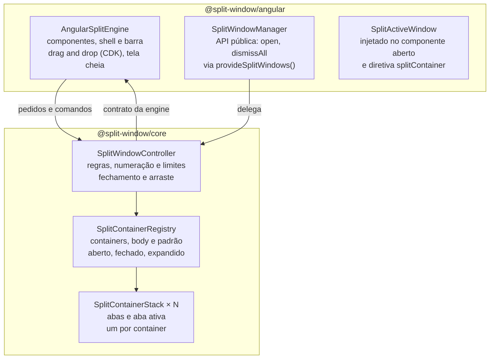

# SplitWindow — Plano v1

20/11/2026 · Lucas Dornelas

Este arquivo reúne as duas partes do plano: a **Parte 1, Especificação**, e a **Parte 2, Plano de implementação**.

---

# Parte 1 — Especificação

## Visão geral

O SplitWindow é uma biblioteca de abas em containers, publicada no escopo `@split-window`. Ela tem um core independente de framework, com o estado e as regras, e um adaptador Angular, que constrói os componentes e segue o padrão de API do `NgbOffcanvas` e do `NgbModal`: `open(content, options)` devolve uma referência para controlar a aba aberta.

A diferença para o offcanvas é que existem vários containers registrados por chave, cada um com o seu próprio stack de abas. As abas funcionam como as de um navegador desktop ou do Explorador de Arquivos do Windows: agrupamento com numeração, reordenação por arraste e movimentação entre containers sem destruir o componente.

Objetivos da v1:

- API de abertura idêntica em formato à do ng-bootstrap, com o container como opção.
- Vários containers (por exemplo, lateral esquerda e direita) renderizados em divs escolhidas pela aplicação, ou nas bordas da janela, todos habilitados explicitamente.
- Barra de abas por container, com numeração por grupo e título.
- Drag and drop para reordenar e para mover abas entre containers, preservando o estado do componente.
- Eventos de ciclo de vida e de movimentação expostos na referência de cada aba.

## Pacotes e camadas

| Pacote | Conteúdo | Depende de |
| --- | --- | --- |
| `@split-window/core` | Estado e regras: registry, stacks, numeração, resolução de container, políticas de limite, fechamento, regras de arraste, estado de tela cheia, eventos e erros. Não cria elementos nem componentes. | `rxjs` |
| `@split-window/angular` | A engine Angular e a API pública para Angular: `provideSplitWindows`, `SplitWindowManager`, `SplitActiveWindow`, a diretiva `splitContainer`, os componentes do shell e o drag and drop com o CDK. | `@split-window/core`, `@angular/core`, `@angular/common`, `@angular/cdk` e `rxjs` |

A divisão deixa espaço para outros adaptadores, como `@split-window/react` e `@split-window/vanilla`, que usariam o mesmo core com uma engine própria.

### Core e engine

O core organiza e decide; a engine constrói e executa.

| Core | Engine |
| --- | --- |
| Registry, stacks, ordem das abas e aba ativa | Criar e destruir o conteúdo da aba (componente ou template) |
| Numeração por grupo + título | Renderizar a barra de abas, os botões e a área de conteúdo |
| Resolução de container e erros | Attach, detach e mover o conteúdo sem destruir |
| Políticas de limite (`maxTabs`, `onFull`, `onReject`) | Drag and drop (CDK no Angular) |
| `canClose`, `force` e fechar tudo sequencial | Zonas de soltura e painel flutuante |
| Estado de aberto, fechado e expandido | Aplicar a tela cheia na tela |
| Regras de arraste (`canMove`, container expandido) | Traduzir cliques e drops em comandos para o core |
| Eventos (RxJS) | Change detection, signals e DI do framework |

**A engine nunca decide: ela pergunta ao core e executa a resposta.** No drop, por exemplo, a engine chama `canDrop(tab, destino)`, e o core aplica `maxTabs`, `canMove` e a restrição de container expandido. Se o movimento for permitido, a engine chama `moveTab(...)`, e o core chama `move()` na engine para executar. Assim, as regras e as camadas de proteção ficam num lugar só e valem para qualquer adaptador.

O core chama a engine nos pontos do ciclo de vida, e a engine lê o estado do core (abas, rótulos, aba ativa, `closable`, expansão) para desenhar a barra:

```ts
interface SplitWindowEngine<TContent, THost, TAdapterOptions = unknown> {
  mountContainer(container: ContainerState<THost>): void;   // cria o shell (e o host, nos containers do body)
  unmountContainer(container: ContainerState<THost>): void;
  setContainerOpen(container: ContainerState<THost>, open: boolean): void; // mostra ou oculta, sem desmontar
  createTab(content: TContent, tab: TabState, ref: SplitWindowRef, adapterOptions?: TAdapterOptions): TabHandle;
  attach(tab: TabHandle, container: ContainerState<THost>, index: number): void;
  move(tab: TabHandle, to: ContainerState<THost>, index: number): void; // sem destruir
  activate(tab: TabHandle): void;
  deactivate(tab: TabHandle): void;
  destroy(tab: TabHandle): void;
  setExpanded(container: ContainerState<THost>, expanded: boolean): void;
  cancelDrag(): void;                                         // a expansão mudou durante um arraste
}
```

- **Tipos genéricos:** `TContent` é o que o adaptador aceita no `open()` (no Angular, `Type<T> | TemplateRef`), e `THost` é o host de um container (no Angular, `HTMLElement`). O registry do core também é genérico em `THost`.
- **Opções do adaptador:** `TAdapterOptions` leva o que só o adaptador entende (no Angular, `inputs` e `injector`). O core repassa sem ler.
- **Notificação de estado:** o controller expõe `changes` (Observable com a chave do container alterado) e `getContainerView(key)`, uma foto imutável do container: abas, rótulos, aba ativa, `closable`, aberto, expandido e fechar tudo em andamento. A engine assina `changes` e redesenha a barra, sem precisar de um método do contrato por propriedade.
- **Host dos containers do body:** `ContainerState.host` é `null` nos containers do body; a engine cria o host no `mountContainer`.
- **Cálculos sem DOM:** o retângulo da tela cheia (`bounds`, `maxWidth`, `margin`, `align`) e a posição do painel flutuante são funções puras no core, que recebem e devolvem retângulos. A engine só mede o DOM e aplica o resultado.
- **Nomes:** o organizador do core se chama `SplitWindowController`, e o registry, `SplitContainerRegistry<THost>`. O adaptador Angular expõe a API pública (`SplitWindowManager`, `provideSplitWindows`), montada a partir do core e da engine, e registra o registry tipado com `HTMLElement`.

## Conceitos

| Termo | Significado |
| --- | --- |
| Core | O pacote `@split-window/core`: estado, regras e eventos, sem criar nada na tela. |
| Engine | A parte de um adaptador que constrói e executa: cria os componentes, renderiza o shell, faz o drag and drop e aplica a tela cheia. |
| Container | Área registrada por chave onde as abas são renderizadas, ligada a uma div host da aplicação, em qualquer posição da página. |
| Container do body | Um dos quatro containers reservados nas bordas da janela (`body-left`, `body-right`, `body-top`, `body-bottom`), habilitados com `useBodyContainers` e criados sob demanda como painéis fixos. |
| Container padrão | Container usado quando o `open()` não informa `containerKey`. Não existe até ser definido por `setDefaultContainer` ou pelo `useBodyContainers`. |
| Stack | Estado de um container: lista ordenada de abas, aba ativa e numeração em uso. Um por container. |
| Aba | Uma instância aberta: componente ou template, título, grupo, número e referência (`SplitWindowRef`). |
| Grupo | Chave opcional (`groupKey`) que separa a numeração. Sem chave, a aba fica no grupo default. |
| Número (ordinal) | Posição da aba dentro do par grupo + título. O número 1 nunca é exibido. |

## Arquitetura

O core organiza e decide, e a engine Angular constrói e executa (ver Pacotes e camadas). No core, o controller delega o estado de cada container a um stack próprio, como o `NgbOffcanvasStack`, mas com uma instância por container e várias abas por stack.



A engine envia pedidos e comandos ao core (abrir, mover, fechar, `canDrop`), e o core chama o contrato da engine para executar. O manager público só delega ao controller.

| Classe | Pacote | Equivalente no ng-bootstrap | Responsabilidade |
| --- | --- | --- | --- |
| `SplitWindowController` | core | — | Organiza a abertura, as regras, a numeração, os limites, o fechamento e o arraste, e chama a engine. |
| `SplitContainerRegistry<THost>` | core | — | Definição dos containers, containers do body, padrão e estado (aberto, fechado, expandido). No Angular, registrado só por `provideSplitWindows()`. |
| `SplitContainerStack` | core | `NgbOffcanvasStack` | Abas, aba ativa e numeração de um container. Um por container, criado sob demanda. |
| `TabGroupResolver` | core | — | Função pura de grupo, número e rótulo. |
| `SplitWindowEngine` | core | — | Interface que cada adaptador implementa. |
| `SplitWindowRef` | core | `NgbOffcanvasRef` | Controle de uma aba e seus eventos. `componentInstance` é preenchido pela engine (no Angular, a instância do componente; `undefined` para templates). |
| `SplitWindowManager` | angular | `NgbOffcanvas` | API pública: `open`, `dismissAll`, `hasOpenWindows` e eventos das abas. Registrado só por `provideSplitWindows()`; expõe o registry em `registry`. |
| `AngularSplitEngine` | angular | — | Cria componentes com `createComponent`, renderiza o shell e faz o drag and drop com o CDK. |
| `SplitContainerComponent` | angular | `NgbOffcanvasPanel` | Shell visual: barra de abas e área de conteúdo. |
| `SplitTabStripComponent` | angular | — | Barra de abas com `cdkDropList`. |
| `SplitActiveWindow` | angular | `NgbActiveOffcanvas` | Injetado no componente aberto: fechar, renomear, container atual como signal. |
| `SplitWindowConfig` | core e angular | `NgbOffcanvasConfig` | Valores padrão das opções de abertura. O tipo fica no core, e o provider no Angular. |
| `SplitContainerDirective` | angular | — | `splitContainer`: registra a div host no registry. |

## API pública

A API abaixo é a do `@split-window/angular`. A abertura segue o formato do ng-bootstrap: o conteúdo no primeiro parâmetro e tudo o mais nas opções, incluindo o container. As opções e os tipos de container são definidos no core e reexportados pelo adaptador.

```ts
@Injectable() // registrado só por provideSplitWindows()
export class SplitContainerRegistry {
  registerContainer(key: string, host: HTMLElement, options?: SplitContainerOptions): void;
  unregisterContainer(key: string): void;
  useBodyContainers(config?: SplitBodyContainersConfig): void; // sem config: só body-right, como padrão
  setDefaultContainer(key: string | null): void; // null: sem padrão
  getDefaultContainer(): string | null;          // null até ser configurado
  hasContainer(key: string): boolean;
  isContainerOpen(key: string): boolean;
  expandContainer(key: string): void;
  restoreContainer(key: string): void;
  isContainerExpanded(key: string): boolean;
  readonly containerStateChanged: Observable<{ key: string; open: boolean; expanded: boolean }>;
}

@Injectable() // registrado só por provideSplitWindows()
export class SplitWindowManager {
  readonly registry: SplitContainerRegistry; // o mesmo singleton injetável

  open<T = any>(content: Type<T> | TemplateRef<any>, options?: SplitWindowOptions): SplitWindowRef<T>;
  dismissAll(options?: { containerKey?: string; reason?: any; force?: boolean }): Promise<SplitCloseAllResult>;
  hasOpenWindows(containerKey?: string): boolean;
  readonly tabMoved: Observable<SplitTabMovedEvent>;
  readonly tabRejected: Observable<SplitTabRejectedEvent>;
}

export interface SplitWindowOptions {
  containerKey?: string;      // sem valor: container padrão
  title?: string;             // sem valor: 'Nova aba'
  groupKey?: string;          // sem valor: grupo default
  inputs?: Record<string, unknown>;
  injector?: Injector;
  activate?: boolean;         // padrão: true
  closable?: boolean;         // padrão: true; false esconde o X e o fechar tudo pula a aba
  canClose?: SplitCloseGuard;  // verificação a cada pedido de fechamento
  canMove?: (target: { containerKey: string; index?: number }) => boolean; // index ausente durante o arraste
}

export interface SplitContainerOptions {
  maxTabs?: number | ((ctx: SplitCapacityContext) => boolean); // função: true = limite atingido
  onFull?: SplitOverflowStrategy | SplitOverflowHandler;          // padrão: 'reject'
  onReject?: SplitRejectStrategy | SplitRejectHandler;            // padrão: 'throw'
  closeWhenEmpty?: boolean;   // fecha sem desregistrar
  label?: string;             // nome exibido na zona de soltura; padrão: a chave
  closedDropZone?: { width?: number; height?: number }; // tamanho do painel flutuante
  closedDropZoneAnchor?: HTMLElement; // âncora do painel quando o host nunca foi medido
  expand?: SplitExpandOptions | false; // padrão: tela cheia na janela; false esconde o botão
}

// Chaves reservadas: 'body-left', 'body-right', 'body-top', 'body-bottom'
export type SplitBodySide = 'left' | 'right' | 'top' | 'bottom';

export interface SplitBodyContainerOptions extends Omit<SplitContainerOptions, 'closedDropZoneAnchor'> {
  size?: string;              // largura (left/right) ou altura (top/bottom): '420px', '30vw'
  backdrop?: boolean;
}

export interface SplitBodyContainersConfig {
  defaults?: SplitBodyContainerOptions;         // vale para todos os lados habilitados
  left?: boolean | SplitBodyContainerOptions;   // true: habilita só com os defaults
  right?: boolean | SplitBodyContainerOptions;
  top?: boolean | SplitBodyContainerOptions;
  bottom?: boolean | SplitBodyContainerOptions;
  default?: SplitBodySide;    // define esse lado como container padrão
}
```

Os métodos de controle de containers ficam só no `SplitContainerRegistry`, que é injetável por conta própria e também acessível pelo manager em `manager.registry`. A dependência vai só do manager para o registry: o registry nunca injeta o manager. Assim, a aplicação pode configurar os containers na inicialização sem instanciar o manager, e não há dependência circular.

O manager e o registry não são `providedIn: 'root'`: os dois só existem quando a aplicação chama `provideSplitWindows()`. O provider só registra os serviços, que são criados na primeira vez que alguém os injeta. Por isso a aplicação ainda pode injetar só o registry num `provideAppInitializer`, sem instanciar o manager. Sem o provider, injetar qualquer um dos dois, ou usar a diretiva `splitContainer`, falha com o erro de injeção do Angular.

```ts
export function provideSplitWindows(config?: Partial<SplitWindowConfig>): EnvironmentProviders {
  return makeEnvironmentProviders([
    SplitContainerRegistry,
    SplitWindowManager,
    { provide: SPLIT_WINDOW_CONFIG, useValue: { ...DEFAULT_SPLIT_WINDOW_CONFIG, ...config } },
  ]);
}
```

Nenhum container existe por padrão. Os containers da aplicação são registrados com `registerContainer` (ou com a diretiva), e os do body são habilitados com `useBodyContainers`, antes ou depois dos outros. `useBodyContainers()` sem argumentos é um atalho para `useBodyContainers({ right: true, default: 'right' })`: habilita só o `body-right`, sem limite de abas, e o define como padrão. Com um objeto, habilita só os lados informados: `defaults` vale para todos eles, e cada lado pode sobrescrever qualquer opção.

As opções são validadas no registro e na abertura. Um valor inválido (`maxTabs` que não é inteiro maior que zero, `size` vazio, chave vazia, `closedDropZone` com tamanho negativo) lança `SplitInvalidOptionError`, com o nome da opção e o valor recebido.

O registry só guarda a definição de cada container. O stack e o shell visual são criados sob demanda, na primeira vez que uma aba é aberta ou movida para o container.

Um `SplitWindowConfig` injetável guarda os valores padrão das opções de abertura, no mesmo padrão do `NgbOffcanvasConfig`.

```ts
// Na inicialização da aplicação, sem o manager
export const appConfig: ApplicationConfig = {
  providers: [
    provideSplitWindows(),
    provideAppInitializer(() => {
      const containers = inject(SplitContainerRegistry);

      // Configuração mínima: só body-right, sem limite, como padrão
      // containers.useBodyContainers();

      containers.useBodyContainers({
        defaults: { maxTabs: 8, onFull: 'replace-lru' },
        left: { size: '360px' },
        right: true,
        bottom: { size: '35vh', maxTabs: 4, onFull: 'reject', onReject: 'redirect-default' },
        default: 'left',
      });
    }),
  ],
};

// Depois, pelo manager, se for mais prático
manager.registry.setDefaultContainer('body-right');
```

Para registrar um container a partir do template, a diretiva `splitContainer` se registra no `ngOnInit` (o host já existe nesse ponto, e um `open()` no `ngOnInit` de um componente posterior já encontra o container) e se desregistra no destroy. As opções do container vão no input `splitContainerOptions`. Trocar a chave depois do registro desregistra a chave antiga e registra a nova.

```html
<div splitContainer="right" [splitContainerDefault]="true" [splitContainerOptions]="{ maxTabs: 5 }"></div>
```

Como o desregistro fecha as abas com `force`, um container dentro de um `@if` ou de uma rota perde as abas quando o host sai da tela. Esse comportamento está documentado; uma alternativa que estacione as abas está em Decisões em aberto.

### SplitWindowRef

```ts
export class SplitWindowRef<T = unknown> {
  readonly id: string;                 // único, estável enquanto a aba existir
  readonly result: Promise<any>;       // resolve no close e rejeita no dismiss
  readonly rejected: boolean;          // true quando o open() foi cancelado pelo onReject 'cancel'
  readonly componentInstance: T | undefined;

  readonly containerKey: string | null; // null depois de fechada ou quando rejeitada
  readonly title: string;
  readonly label: string;               // título com o número, como aparece na barra
  readonly groupKey: string | null;
  readonly closable: boolean;
  readonly isActive: boolean;
  readonly isOpen: boolean;

  close(result?: any, options?: { force?: boolean }): Promise<boolean>;
  dismiss(reason?: any, options?: { force?: boolean }): Promise<boolean>;
  activate(): void;
  moveTo(containerKey: string, index?: number): boolean;
  setTitle(title: string): void;
  setClosable(closable: boolean): void;
  setCanClose(guard: SplitCloseGuard | null): void;
  setCanMove(guard: SplitMoveGuard | null): void;

  // Eventos (ver Eventos); todos completam depois de hidden
  readonly closed: Observable<any>;
  readonly dismissed: Observable<any>;
  readonly closePrevented: Observable<{ trigger: SplitCloseTrigger; reason?: any }>;
  readonly hidden: Observable<void>;
  readonly activated: Observable<void>;
  readonly deactivated: Observable<void>;
  readonly titleChanged: Observable<{ title: string; label: string }>;
  readonly dragStarted: Observable<void>;
  readonly dragEnded: Observable<{ moved: boolean }>;
  readonly reordered: Observable<{ from: number; to: number }>;
  readonly containerChanged: Observable<{ fromKey: string; toKey: string; index: number; label: string }>;
}
```

- **`result` sem rejeição não tratada:** como no ng-bootstrap, o core anexa um tratador vazio à promise, para que `dismiss` e `cancel` não gerem "Uncaught (in promise)" em quem não usa o `result`.
- **`moveTo(containerKey, index?)`:** sem `index`, a aba vai para o fim da barra. Lança `SplitContainerNotFoundError` para chave desconhecida. Aplica `canMove` e `maxTabs` (com `source: 'move'`); se o destino recusar, devolve `false`, sem aplicar `onReject`. A recusa por limite de abas dispara `tabRejected` com `resolution: 'move-refused'`; o veto do `canMove` não dispara evento. Ignora a restrição de container expandido. Devolve `true` quando a aba mudou de lugar.
- **`activate()`:** ativa a aba no container atual.

## Resolução de container

O container de cada abertura é resolvido em cascata, `options.containerKey ?? defaultKey`. Nenhum container existe, nem é padrão, até ser configurado.

1. Se `containerKey` foi informado, usa esse container. Se não houver container configurado com essa chave, lança `SplitContainerNotFoundError`, sem cair no padrão em silêncio (cair no padrão esconderia erros de digitação).
2. Se não foi informado, usa o container padrão, definido por `setDefaultContainer` ou pelo `default` do `useBodyContainers`. O `useBodyContainers()` sem argumentos define o `body-right`.
3. Se não foi informado e não há container padrão, lança `SplitNoDefaultContainerError`.

Cada caso tem o seu erro, com uma mensagem que diz o que configurar:

| Erro | Quando | Mensagem |
| --- | --- | --- |
| `SplitContainerNotFoundError` | `containerKey` informado, sem container com essa chave | Nenhum container configurado com a chave 'contratos'. Containers disponíveis: body-right, painel-esquerdo. |
| `SplitContainerNotFoundError` | `containerKey` de um lado do body não habilitado | O container 'body-left' não está habilitado. Habilite-o com useBodyContainers(). |
| `SplitNoDefaultContainerError` | `containerKey` não informado, sem container padrão | Nenhum container padrão configurado. Informe containerKey no open() ou defina um padrão com setDefaultContainer() ou useBodyContainers(). |

Os dois erros expõem os dados da mensagem como propriedades: `containerKey` e `availableKeys` no primeiro, `availableKeys` no segundo.

### Containers do body

- **Até quatro, um por borda da janela:** `'body-left'`, `'body-right'`, `'body-top'` e `'body-bottom'`. Essas chaves são reservadas.
- **Nenhum vem habilitado.** `useBodyContainers()` sem argumentos equivale a `{ right: true, default: 'right' }`. Com um objeto, habilita só os lados informados, com `true` (apenas os `defaults`) ou um objeto de opções, e o padrão só muda se `default` for informado.
- **Funcionam como o offcanvas do ngb:** cada um é criado no primeiro `open()` que cair nele, fica fixo na sua borda, tem a mesma barra de abas e fecha quando fica vazio (`closeWhenEmpty` é `true` por padrão no body e `false` nos outros containers).
- **Reconfiguração:** `useBodyContainers` pode ser chamado de novo, antes ou depois de registrar outros containers. A configuração nova substitui a anterior: lados não informados ficam desabilitados, e as abas abertas neles recebem `dismiss('container-removed')`. Lados mantidos conservam as abas e recebem as opções novas; um `maxTabs` menor que o número de abas abertas só vale para as próximas chegadas.
- **Backdrop:** com `backdrop: true`, a página atrás do container fica bloqueada enquanto ele está aberto. Clicar no backdrop não fecha abas.
- **Padrão removido:** desabilitar o lado que é o padrão, ou desregistrar o container padrão, deixa a aplicação sem padrão até um novo `setDefaultContainer`.

## Limite de abas

Quando um container atinge o limite, duas políticas decidem o que acontece: `onFull` escolhe entre rejeitar a aba nova e substituir uma existente, e `onReject` decide o destino de uma aba rejeitada. Ambas têm valores pré-definidos e aceitam uma função para comportamento customizado.

### maxTabs

- **Número:** limite fixo de abas.
- **Função:** `(ctx) => boolean`, chamada a cada abertura ou movimento para o container. Retorna `true` quando o container está cheio para a aba que está chegando.

```ts
interface SplitCapacityContext {
  containerKey: string;
  tabs: readonly SplitWindowRef[];   // abas atuais, na ordem da barra
  incoming: SplitWindowOptions;      // opções da aba que está chegando
  source: 'open' | 'move';
}
```

### onFull: rejeitar ou substituir

| Valor | Comportamento |
| --- | --- |
| `'reject'` (padrão) | Recusa a aba nova e aplica `onReject`. |
| `'replace-oldest'` | Fecha a aba aberta há mais tempo. |
| `'replace-lru'` | Fecha a aba ativada pela última vez há mais tempo. |
| `'replace-same-label'` | Fecha a aba mais antiga com o mesmo grupo e título da nova. Se não houver, rejeita. |
| Função | Devolve qual aba substituir ou que a nova deve ser rejeitada (tipo abaixo). |

- **A substituição é síncrona**, porque o `open()` devolve a ref na hora e o `canClose` pode ser assíncrono. Por isso abas com `canClose` nunca são substituídas e o `canClose` não é chamado. A aba substituída recebe `dismiss('replaced')` sem verificação.
- As estratégias pré-definidas nunca substituem a aba ativa, abas com `canClose` nem abas com `closable: false`. Se nenhuma aba servir, a aba nova é rejeitada. Com `maxTabs: 1`, a única aba é a ativa, então as estratégias pré-definidas sempre rejeitam.
- Se uma função de `onFull` devolver uma aba com `canClose`, ou que não está no container, a aba nova é rejeitada.
- Em movimentos (`source: 'move'`), as estratégias pré-definidas só rejeitam: soltar uma aba não deve fechar outra sem aviso. Uma função customizada recebe o `source` e pode decidir diferente.

### onReject: o que fazer com a aba rejeitada

| Valor | Comportamento |
| --- | --- |
| `'throw'` (padrão) | `open()` lança `SplitContainerFullError`. |
| `'redirect-default'` | Abre no container padrão. |
| `'cancel'` | Não cria o componente. `open()` devolve uma ref já rejeitada: `rejected: true` e `result` rejeitado com `'container-full'`. |
| Função | Devolve `throw`, `cancel` ou um container para redirecionar, que pode ser um lado do body (tipo abaixo). |

- Um redirecionamento passa pelas políticas do container de destino.
- Um container já tentado na mesma abertura não é tentado de novo. Se a cadeia se esgotar (destino já tentado, ou `redirect-default` sem container padrão), `open()` lança `SplitContainerFullError` com a lista de containers tentados.
- Em movimentos, `onReject` não se aplica: o arraste é cancelado e a aba volta à posição original.
- Toda rejeição dispara `tabRejected` no manager, com o contexto e a resolução aplicada.

```ts
type SplitOverflowStrategy = 'reject' | 'replace-oldest' | 'replace-lru' | 'replace-same-label';
type SplitOverflowHandler = (ctx: SplitCapacityContext) =>
  { action: 'reject' } | { action: 'replace'; ref: SplitWindowRef };

type SplitRejectStrategy = 'throw' | 'redirect-default' | 'cancel';
type SplitRejectHandler = (ctx: SplitCapacityContext) =>
  { action: 'throw' | 'cancel' } | { action: 'redirect'; containerKey: string };
```

Os handlers são síncronos, porque `open()` devolve a ref de forma síncrona.

## Container fechado

Com `closeWhenEmpty`, um container que fica sem abas é fechado, não removido: o shell fica oculto, mas o container continua registrado, com o stack e a lista de soltura do CDK ativos.

- **Abrir ou mover uma aba para um container fechado reabre o container**, pelo `open()` ou pelo `moveTo()`.
- **Durante um arraste, containers fechados aparecem como um painel flutuante** (ver Zonas de soltura). Soltar ali reabre o container com a aba.
- **Os containers do body seguem a mesma regra:** cada um é criado no primeiro uso, fecha quando fica vazio e não é destruído depois disso.
- **Estado consultável:** `isContainerOpen(key)` e o evento `containerStateChanged` no registry.

### Zonas de soltura

Durante um arraste, todo container que pode receber a aba vira uma zona de soltura. O formato depende do estado do container:

| Estado | Zona | Onde a aba cai |
| --- | --- | --- |
| Aberto | O próprio container, com o contorno destacado | Na barra de abas: na posição do placeholder. Na área de conteúdo: no fim da barra. |
| Fechado | Painel flutuante pequeno, de tamanho pré-definido, com o `label` do container | Em qualquer ponto do painel: o container reabre com a aba. |

- **Painel flutuante:** `position: fixed`, mostrado pela engine no início do arraste e ocultado no fim. Na engine Angular, cada container fechado tem um painel oculto já montado numa camada no body, para que a lista do CDK exista antes do arraste; o `cdkDragStarted` dispara antes de o CDK medir as listas conectadas, então os painéis são posicionados e mostrados a tempo. O tamanho padrão vem do `SplitWindowConfig` e pode ser trocado por container com `closedDropZone`.
- **Posição do painel:** definida pelo próprio host, onde quer que ele esteja na página:
  - Host com tamanho: centralizado sobre o retângulo do host.
  - Host recolhido (largura ou altura 0, ainda no layout): centralizado no ponto onde o host está.
  - Host com `display: none`: usa o último retângulo conhecido do host, registrado quando ele estava visível.
  - Host nunca medido: usa `closedDropZoneAnchor`. Sem âncora, o container não mostra zona e só recebe abas pelo `moveTo()`.
  - Containers do body: o painel fica na borda da janela do lado do container.
- **Detecção:** cada zona é um `cdkDropList` conectado às barras de abas. A área de conteúdo e o painel flutuante usam `cdkDropListSortingDisabled`, e o `cdkDropListEnterPredicate` continua aplicando `maxTabs` e `canMove`.
- **Destaque:** o contorno ou o painel se destacam no `cdkDropListEntered` e voltam ao normal no `cdkDropListExited`. Uma zona recusada pelo predicate não se destaca.
- **Container de origem:** soltar na área de conteúdo do próprio container de origem é ignorado, e a aba volta à posição original.

## Agrupamento e numeração

A numeração é calculada por grupo + título, dentro de cada container: a primeira aba de cada par nunca mostra número, e as seguintes recebem " (2)", " (3)" e assim por diante.

| Abertura | Grupo | Rótulos |
| --- | --- | --- |
| Sem grupo e sem título, 3 vezes | default | Nova aba · Nova aba (2) · Nova aba (3) |
| Título "Contrato", sem grupo, 2 vezes | default | Contrato · Contrato (2) |
| Títulos diferentes no mesmo grupo | qualquer | Sem número |
| "Contrato" 1 vez no grupo A e 2 vezes no grupo B | A e B | A: Contrato · B: Contrato, Contrato (2) |

Regras:

- **O número é fixado na abertura e não muda quando outras abas fecham.** Se "Contrato" fechar, "Contrato (2)" continua "(2)". Só duas coisas mudam o número de uma aba: o `setTitle()` dela e a troca de container (ver Drag and drop).
- **Uma aba nova pega o menor número livre**, como no Explorer. Depois de fechar "Contrato", a próxima volta a ser "Contrato".
- **`setTitle()` move a aba de par.** O número antigo é liberado e um novo é calculado no novo título. As outras abas não mudam.

Os números em uso ficam num `Map<grupo, Map<título, Set<number>>>` no stack. Maps aninhados evitam colisões que uma chave concatenada ("grupo::título") teria.

```ts
function nextOrdinal(used: Set<number>): number {
  let n = 1;
  while (used.has(n)) n++;
  return n;
}

const label = (title: string, ordinal: number) =>
  ordinal === 1 ? title : `${title} (${ordinal})`;
```

## Ciclo de vida das abas

Na engine Angular, cada aba é criada uma vez com `createComponent` e anexada ao `ApplicationRef`, sem ficar presa ao `ViewContainerRef` de nenhum container. Isso permite trocar de aba e de container movendo só o elemento host no DOM.

1. **Abrir:** resolve o container, cria o componente (ou a view do template) com o injector das opções, calcula o número, registra a aba no stack e, com `activate: true`, ativa a aba. Sem `injector` nas opções, o pai é o `EnvironmentInjector` do manager, como no `NgbModal`: o manager é um serviço de ambiente e não conhece o injector de quem chama. A primeira aba de um container vazio fica ativa mesmo com `activate: false`, para a área de conteúdo nunca ficar em branco.
2. **Ativar:** a aba ativa fica visível e com change detection ligado. As inativas ficam ocultas e com o change detection desligado por `ChangeDetectorRef.detach()` na view do próprio componente, sem serem destruídas. A view continua anexada ao `ApplicationRef` durante toda a vida da aba: `appRef.detachView()` também remove os nós do DOM, e o tick da aplicação ignora a flag de anexado das views raiz.
   - Cada aba vive num elemento próprio da engine (`div` com `role="tabpanel"`). O componente ou todos os nós raiz do template ficam dentro dele, e é esse elemento que se move entre containers.
3. **Fechar:** `close(result)` resolve o `result`, e `dismiss(reason)` o rejeita. Os dois passam antes pelo `canClose`, a menos que recebam `{ force: true }` (ver Fechamento de abas). Só depois disso o componente é destruído e o número é liberado.
4. **Fechar a aba ativa:** a aba à direita é ativada; sem ela, a da esquerda. Se o container ficar vazio e tiver `closeWhenEmpty` (padrão no body), ele é fechado: fica oculto, mas continua registrado e pode receber abas. Sem `closeWhenEmpty`, o shell continua visível, com a barra vazia e um texto de container vazio vindo do `SplitWindowConfig`.
5. **Abrir pela primeira vez:** um container é montado e aberto na primeira aba que recebe. Antes disso, `isContainerOpen` devolve `false`.

Cada aba é registrada no stack por identidade, num `Map<id, SplitWindowRef>`, e remove só a si mesma ao fechar. Isso evita o problema do `NgbOffcanvasStack`, em que uma referência única é sobrescrita a cada `open()` e o fechamento de uma instância desregistra a outra.

## Fechamento de abas

Cada aba tem um botão de fechar, e a barra de abas termina com os botões de tela cheia e de fechar tudo. Os dois disparam um pedido de fechamento, que passa pela verificação `canClose` da aba antes de fechar de fato.

Na barra, o `role="tab"` fica no rótulo, e o botão de fechar é um irmão dele, fora do tab: um controle dentro de um `tab` é um controle interativo aninhado, que leitores de tela não anunciam bem. O botão fica oculto da tecnologia assistiva (`aria-hidden`, fora da ordem de tabulação), e a tecla Delete fecha a aba focada, anunciada por `aria-keyshortcuts`.

Teclado na barra, no padrão de abas do WAI-ARIA com ativação automática: setas esquerda e direita, Home e End trocam e ativam a aba; Delete fecha; Ctrl+Shift+setas reordenam.

### Configuração

| Opção | O que faz | Onde configurar |
| --- | --- | --- |
| `closable` | `false` esconde o X da aba, e o fechar tudo pula essa aba. O código ainda pode fechá-la. | `open()`, `ref.setClosable()` e `SplitActiveWindow.setClosable()` |
| `canClose` | Função chamada a cada pedido de fechamento. Retorna `boolean`, `Promise<boolean>` ou `Observable<boolean>`: `true` fecha, `false` mantém a aba aberta. | `open()`, `ref.setCanClose()` e `SplitActiveWindow.setCanClose()` |

```ts
type SplitCloseGuard = (ctx: SplitCloseContext) =>
  boolean | Promise<boolean> | Observable<boolean>;

interface SplitCloseContext {
  ref: SplitWindowRef;
  trigger: SplitCloseTrigger;
  reason?: any;
}

type SplitCloseTrigger = 'tab-button' | 'close-all' | 'close' | 'dismiss';
```

Exemplos: confirmação com um modal na abertura, e uma verificação definida pelo próprio componente.

```ts
// Na abertura
this.manager.open(ContratoDetalheComponent, {
  title: 'Contrato',
  canClose: () => this.modal.open(ConfirmarFechamentoComponent).result.then(() => true, () => false),
});

// Dentro do componente aberto
private active = inject(SplitActiveWindow);

constructor() {
  this.active.setCanClose(() => !this.form.dirty || this.confirmarDescarte());
}
```

Regras da verificação:

- **Observable:** vale o primeiro valor emitido. Se completar sem emitir, ou der erro, a aba fica aberta.
- **Promise rejeitada ou exceção:** a aba fica aberta, e o erro é registrado no console.
- **Pedido em andamento:** enquanto a verificação de uma aba não termina, novos pedidos para a mesma aba não chamam o `canClose` de novo, para não abrir dois modais: eles devolvem a mesma promise do pedido em andamento.
- **Passam pela verificação:** todo fechamento pelo X da aba, pelo fechar tudo, por `close()`, `dismiss()` ou `dismissAll()` (no ref ou no `SplitActiveWindow`).
- **Pular a verificação:** `close(result, { force: true })`, `dismiss(reason, { force: true })` e `dismissAll({ force: true })` fecham sem chamar o `canClose`. As remoções do sistema (`unregisterContainer`, lado do body desabilitado e substituição por `onFull`) sempre usam `force`.
- **`force` durante uma verificação:** um fechamento com `force` fecha a aba na hora; a verificação em andamento é ignorada quando terminar.
- **Retorno:** `close()` e `dismiss()` devolvem `Promise<boolean>`, que resolve com `true` se a aba fechou.

```ts
close(result?: any, options?: { force?: boolean }): Promise<boolean>;
dismiss(reason?: any, options?: { force?: boolean }): Promise<boolean>;
```

### Fechar tudo

O botão de fechar tudo chama `dismissAll({ containerKey })` para o próprio container. Sem `containerKey`, o `dismissAll` vale para todos os containers. O processo é sequencial:

1. Registra as abas do container na ordem da barra. Abas abertas depois disso não entram; abas que fecharem por outro caminho durante o processo são puladas.
2. Percorre as abas em ordem, pulando as que têm `closable: false`, mesmo com `force`. Para fechar uma delas, o código chama `close()` ou `dismiss()` na ref.
3. Abas sem `canClose` fecham na hora.
4. Ao chegar numa aba com `canClose`, ativa essa aba, para o usuário ver o que está confirmando, e espera a resposta.
5. Com `true` a aba fecha; com `false` ela fica aberta. Nos dois casos, o processo continua nas abas seguintes, com as mesmas regras.
6. No fim, a promise resolve com as abas fechadas e as mantidas.

Enquanto o processo roda, o botão de fechar tudo fica desabilitado.

```ts
interface SplitCloseAllResult {
  closed: SplitWindowRef[];
  kept: SplitWindowRef[];   // recusadas pelo canClose ou com closable: false
}
```

## Tela cheia

Ao lado do botão de fechar tudo, a barra de abas tem um botão de tela cheia. Por padrão, ele expande o container para ocupar a janela inteira; cada container pode limitar a expansão a uma área de referência e a tamanhos máximos, com a opção `expand`.

```ts
export interface SplitExpandOptions {
  bounds?: 'viewport' | HTMLElement | string | (() => DOMRect); // padrão: 'viewport'; string = seletor CSS
  maxWidth?: number | string;   // ex.: 1200 ou '90vw'
  maxHeight?: number | string;
  margin?: number;              // espaço livre dentro da área, em px; padrão: 0
  align?: 'center' | 'start' | 'end'; // posição na área quando o tamanho máximo é menor; padrão: 'center'
  restoreOnEscape?: boolean;    // padrão: true
}
```

Com `expand: false`, o botão não aparece e `expandContainer` é ignorado. Expandir um container fechado também é ignorado.

`maxWidth` e `maxHeight` aceitam número (px) ou texto em `px`, `vw`, `vh` ou `%` (da área de referência). A conversão é uma função pura do core.

Como a expansão funciona:

1. Calcula a área: a janela, o retângulo do elemento de referência ou o retângulo devolvido pela função, descontando `margin`.
2. Aplica `maxWidth` e `maxHeight` e posiciona o container na área conforme `align`.
3. O shell do container passa a `position: fixed` com esse retângulo, acima do resto da página. O host continua no lugar, com o tamanho original, para o layout não pular.
4. Um `ResizeObserver` na referência e o evento `resize` da janela recalculam o retângulo enquanto o container estiver expandido.
5. Clicar de novo no botão, apertar Esc ou chamar `restoreContainer` devolve o container ao tamanho e à posição originais.

Regras:

- **Ancestral que quebra o `position: fixed`:** `transform`, `filter`, `contain`, `will-change`, `perspective`, `backdrop-filter` e `container-type` num ancestral fazem o `position: fixed` ficar relativo a ele, e não à janela. Em vez de procurar essas propriedades uma a uma, a engine aplica o retângulo e mede o shell: se a posição medida não for a calculada, o shell é movido para uma camada no body, com o mesmo mecanismo de movimentação das abas (`moveBefore()` quando disponível), e volta ao host ao restaurar.
- **Esc:** o atalho é ouvido no próprio shell, e só vale quando o foco está dentro dele e o evento não foi tratado antes (`defaultPrevented`). Assim, o Esc que fecha um modal de confirmação aberto pelo `canClose`, que fica fora do shell, não restaura o container.
- **Camadas:** o shell expandido usa `--split-expanded-z-index`, e a prévia de arraste do CDK usa `--split-drag-preview-z-index`, acima dele.
- **Um por vez:** expandir um container restaura o que estiver expandido.
- **Container que fecha:** se o container expandido fica vazio e fecha, ele é restaurado.
- **Arraste:** enquanto um container está expandido, o arraste de abas fica restrito a ele e só reordena abas dentro do próprio container (ver Drag and drop).
- **API no registry:** `expandContainer(key)`, `restoreContainer(key)` e `isContainerExpanded(key)`. O evento `containerStateChanged` passa a incluir `expanded`.

## Drag and drop

Na engine Angular, o arraste usa o `DragDropModule` do Angular CDK e passa sempre pelo mesmo método do arraste programático, `ref.moveTo(containerKey, index?)`. O drag and drop nativo do HTML5 foi descartado por dar pouco controle sobre o preview e funcionar mal com toque.

| Requisito | Como o CDK resolve |
| --- | --- |
| Só a aba arrasta | `cdkDrag` no elemento da aba e `cdkDragHandle` na área do título, para o botão de fechar não iniciar arraste. O conteúdo não é arrastável. |
| Sombra da posição final | `cdkDragPlaceholder` mostra onde a aba vai cair. `cdkDragPreview` desenha a aba que segue o cursor. |
| Soltar em lugar inválido cancela | O CDK anima a aba de volta à posição original. |
| Mover entre containers | `cdkDropListConnectedTo` ligado aos ids do registry, como signal. `cdkDropListGroup` não serve, porque os containers do body ficam numa árvore de DOM separada. |
| Bloquear destinos | `cdkDropListEnterPredicate` recusa o destino cheio (`maxTabs`) ou vetado por `canMove`. |

No drop, a barra de abas não altera arrays com o `transferArrayItem` do CDK. Ela chama `moveTo`, que tira a aba do stack de origem sem destruí-la, insere no stack de destino e dispara os eventos.

A engine nunca decide se um movimento é permitido. No `cdkDropListEnterPredicate` e no drop, ela chama `canDrop(tab, destino)` no core, que aplica `maxTabs`, `canMove` e a restrição de container expandido. As regras desta seção ficam no core e valem para qualquer adaptador; o CDK é só a forma como o Angular as executa.

### Mover sem destruir

Como o componente está anexado ao `ApplicationRef`, mover a aba é mover o elemento host para a área de conteúdo do outro container. Não há `ngOnDestroy` nem recriação.

- **`moveBefore()` quando disponível (Chrome 133+).** O `appendChild` recarrega iframes, reinicia vídeos e perde o foco. O `moveBefore()` move preservando esse estado. Nos outros navegadores, o fallback é o `appendChild`, e a limitação fica documentada.
- **Container reativo no conteúdo.** O `SplitActiveWindow` expõe `containerKey()` como signal, porque a aba pode mudar de container depois de criada.

### Regras na troca de container

- O número é recalculado no destino e liberado na origem. "Contrato (2)" pode virar "Contrato" no destino.
- A aba movida fica ativa no destino.
- Se a aba movida era a ativa na origem, a vizinha é ativada. Se a origem ficar vazia e tiver `closeWhenEmpty`, ela é fechada, mas continua registrada e pode receber abas.

### Arraste com container expandido

Com um container expandido, o arraste de abas fica restrito a ele: as abas só são reordenadas dentro do próprio container, e nenhum outro container recebe abas, mesmo que esteja logo abaixo do cursor.

A proteção tem várias camadas, para que uma falha numa delas não cause um movimento indevido:

1. **Conexões:** ao expandir, o `cdkDropListConnectedTo` do container expandido fica vazio, e os outros containers saem da lista de conexões.
2. **Predicate:** o `cdkDropListEnterPredicate` de todos os outros containers recusa qualquer aba enquanto houver um container expandido.
3. **Zonas de soltura:** nenhum painel flutuante é criado durante o arraste.
4. **Validação no drop:** antes de chamar `moveTo`, o handler do drop confere se o destino é o próprio container expandido. Se não for, cancela o arraste.
5. **Mudança no meio do arraste:** o botão de tela cheia fica desabilitado durante um arraste. Se a expansão mudar por API durante um arraste, o core chama `cancelDrag()` na engine e ignora o drop seguinte; a aba volta à posição original. O CDK não tem uma API pública de cancelamento, então a engine Angular encerra o arraste com um `mouseup` fora de qualquer lista.

O `moveTo()` programático continua permitido, porque é uma decisão explícita do código.

## Eventos

Cada `SplitWindowRef` expõe o ciclo de vida da aba e da movimentação; o manager expõe um stream global para quem observa todas as abas.

| Evento | Onde | Quando dispara | Payload |
| --- | --- | --- | --- |
| `result` | Ref | Promise resolvida no `close` e rejeitada no `dismiss` aprovado | resultado ou motivo |
| `closed` / `dismissed` | Ref | Ao fechar, antes de destruir | resultado ou motivo |
| `closePrevented` | Ref | Quando o `canClose` recusa um pedido de fechamento | `{ trigger, reason }` |
| `hidden` | Ref | Depois que o componente é destruído | — |
| `activated` / `deactivated` | Ref | Ao ganhar ou perder o foco de aba ativa | — |
| `titleChanged` | Ref | Após `setTitle()` ou recálculo do número | `{ title, label }` |
| `dragStarted` | Ref | Início do arraste | — |
| `dragEnded` | Ref | Fim do arraste, válido ou cancelado | `{ moved: boolean }` |
| `reordered` | Ref | Mudança de posição no mesmo container | `{ from, to }` |
| `containerChanged` | Ref | Mudança de container | `{ fromKey, toKey, index, label }` |
| `tabMoved` | Manager | Qualquer `reordered` ou `containerChanged` | `{ ref, ...detalhes }` |
| `tabRejected` | Manager | Aba recusada por limite de abas | contexto e resolução aplicada |
| `containerStateChanged` | Registry | Container aberto, fechado, expandido ou restaurado | `{ key, open, expanded }` |

Soltar no mesmo lugar, ou fora de uma lista válida, gera só `dragEnded` com `moved: false`. Os eventos de movimentação disparam tanto no arraste quanto no `moveTo` programático, já que os dois passam pelo mesmo método.

Todos os observables de uma ref completam depois de `hidden`, e os do manager e do registry completam quando o injector do ambiente é destruído, para não deixar assinaturas penduradas.

## Casos de borda e erros

| Situação | Comportamento |
| --- | --- |
| `open()` sem `containerKey` e sem container padrão | Lança `SplitNoDefaultContainerError`. |
| `open()` ou `moveTo()` com `containerKey` sem container configurado | Lança `SplitContainerNotFoundError`. |
| `setDefaultContainer` com chave não configurada ou lado do body desabilitado | Lança `SplitContainerNotFoundError`. |
| `registerContainer` com uma chave `body-*` | Lança erro: chaves reservadas. |
| `registerContainer` com chave já registrada | Lança erro. Para trocar o host, desregistre antes. |
| `unregisterContainer` do container padrão | A aplicação fica sem padrão. As abas do container recebem `dismiss`. |
| `unregisterContainer` com abas abertas | As abas recebem `dismiss` com motivo `'container-removed'`. |
| Desabilitar um lado do body com abas abertas | As abas recebem `dismiss('container-removed')`. |
| Desabilitar o lado do body que é o padrão | A aplicação fica sem padrão. |
| Container sem abas com `closeWhenEmpty` | Fecha (fica oculto), mas continua existindo e pode receber abas. |
| Arraste para container cheio (`maxTabs`) ou vetado por `canMove` | Destino recusado; a aba volta à posição original. |
| Arraste com um container expandido | Só reordena dentro dele. Os outros containers recusam a aba, mesmo sob o cursor. |
| Expansão alterada durante um arraste | O arraste é cancelado e a aba volta à posição original. |
| `open()` em container cheio | Aplica `onFull` e, se rejeitar, `onReject` (ver Limite de abas). |
| `canClose` retorna `false` | A aba não fecha, e o ref dispara `closePrevented`. |
| Opção com valor inválido | Lança `SplitInvalidOptionError`, com o nome da opção e o valor. |
| `moveTo()` para destino cheio ou vetado por `canMove` | Devolve `false` e dispara `tabRejected`; a aba fica onde está. |
| `expandContainer` com `expand: false` ou container fechado | Ignorado. |
| `onFull` sem aba que possa ser substituída | A aba nova é rejeitada e segue para o `onReject`. |
| Cadeia de redirecionamento esgotada | Lança `SplitContainerFullError`, com os containers tentados. |
| Host de um container destruído (`@if`, rota) | A diretiva desregistra o container, e as abas recebem `dismiss('container-removed')`. |
| Operação numa ref já fechada | `close`, `dismiss` e `moveTo` não fazem nada e devolvem `false`; os setters são ignorados. |

## Distribuição como biblioteca

A biblioteca é publicada no npm, no escopo `@split-window`, a partir de um monorepo.

- **Monorepo:** `packages/core`, `packages/angular` e `apps/demo-angular`, que também serve aos testes end-to-end. A estrutura deixa espaço para `packages/react` e `packages/vanilla`.
- **Build:** o core é compilado para ESM com tipos pelo `tsc`; o adaptador Angular é empacotado no Angular Package Format pelo builder `@angular/build:library`, sucessor do ng-packagr no Angular 22.
- **Dependências:** o core tem só `rxjs` como peer dependency. O adaptador Angular depende do core com a mesma versão e tem `@angular/core`, `@angular/common`, `@angular/cdk` e `rxjs` como peer dependencies. Nenhum pacote depende do ng-bootstrap nem do Bootstrap.
- **API pública:** cada pacote tem um único ponto de entrada. O adaptador Angular reexporta os tipos do core que o usuário precisa, para quem usa Angular importar só de `@split-window/angular`.
- **Estilos:** CSS com variáveis (custom properties) no adaptador Angular; o core não tem estilos.
- **Textos:** o título padrão ('Nova aba'), o texto de container vazio e os rótulos acessíveis dos botões ficam no `SplitWindowConfig`, em `labels`, e podem ser traduzidos no `provideSplitWindows()`.
- **SSR:** o adaptador funciona no servidor sem erro. `window`, `document`, `ResizeObserver` e `moveBefore()` só são usados no navegador; no servidor, a engine não monta shells e não mede nada.
- **Versionamento:** semver em lockstep: os pacotes saem juntos, com a mesma versão e um changelog.
- **Escopo no npm:** criar a organização `split-window` no npm antes da primeira publicação, para reservar o escopo.

### App de demonstração

O workspace inclui um app de demonstração com uma tela por tema e um playground. Cada tela mostra o resultado ao lado do código usado, e juntas elas cobrem todas as opções da biblioteca.

| Tela | O que demonstra |
| --- | --- |
| Início rápido | `provideSplitWindows()`, `useBodyContainers()` e um `open()` simples |
| Containers | Containers registrados pela diretiva e por `registerContainer`, em várias posições da página, e o container padrão |
| Containers do body | Os quatro lados, `defaults` com sobrescrita por lado, `size`, `backdrop` e reconfiguração |
| Abas e numeração | Títulos, grupos, números, `setTitle()` e ativação |
| Limite de abas | `maxTabs` como número e como função, cada estratégia de `onFull` e de `onReject`, e handlers customizados |
| Fechamento | `closable`, `canClose` com `boolean`, `Promise` e `Observable`, confirmação com modal, `force` e o fechar tudo sequencial |
| Drag and drop | Reordenar, mover entre containers, zonas de soltura, container fechado e `canMove` |
| Tela cheia | `expand` com `bounds`, `maxWidth`, `maxHeight`, `margin`, `align` e a restrição de arraste |
| Eventos | Log ao vivo de todos os eventos do ref, do manager e do registry |
| Erros | Os erros de resolução e as chaves reservadas |
| Playground | Formulário com todas as opções de container e de abertura. Cada mudança reaplica a configuração, e a tela mostra o código equivalente para copiar. |

### Documentação

- **README:** instalação, configuração mínima e um exemplo de uso.
- **Guias:** um por tema, na mesma divisão das telas do app de demonstração, com links para elas.
- **Referência da API:** gerada a partir dos comentários TSDoc do código.
- **Exemplos sempre atualizados:** o código dos guias vem dos exemplos do app de demonstração, que rodam nos testes. Se um exemplo quebrar, o CI falha.
- **Publicação:** o app de demonstração e a documentação são publicados num site estático a cada versão.

## Testes

Cada fase do plano só termina com os testes da parte entregue. A estratégia segue a pirâmide: muitos testes unitários no núcleo de dados, testes de componente na UI e poucos testes end-to-end nos fluxos que dependem do navegador real.

| Camada | Ferramenta | O que cobre |
| --- | --- | --- |
| Core | Vitest, sem DOM, com uma engine falsa em memória | Todas as regras: numeração, registry, resolução e erros, limites, `canClose` e fechar tudo, regras de arraste e de container expandido, cálculos de tela cheia e de zonas, e as chamadas feitas à engine |
| Engine Angular | TestBed com harnesses próprios | Criação e destruição de componentes, attach sem destruir, barra de abas, botões, `closable`, `SplitActiveWindow`, diretiva e integração com o CDK |
| End-to-end | Playwright, em Chromium, Firefox e WebKit, sobre o app de demonstração | Arraste real, zonas de soltura, tela cheia, preservação de estado ao mover, teclado e acessibilidade |

Os cenários end-to-end são escritos sem depender do framework, para rodar também contra os apps de demonstração de futuros adaptadores.

Casos que precisam de teste:

- **Numeração:** menor número livre, primeira aba sem número, `setTitle` mudando de par, contagens independentes por grupo e por container.
- **Registro por identidade:** fechar uma aba nunca desregistra outra, como regressão do problema do `NgbOffcanvasStack`.
- **Resolução:** os dois erros, com mensagens e chaves disponíveis; `useBodyContainers()` sem argumentos; reconfiguração que desabilita lados com abas abertas.
- **Limite de abas:** cada estratégia de `onFull` e de `onReject`, `maxTabs` como função e redirecionamento em cadeia sem loop.
- **Fechamento:** `canClose` com `boolean`, `Promise` e `Observable`; Observable que completa sem emitir; erro na verificação; `force`; fechar tudo que espera uma confirmação e continua nas abas seguintes, com `true` e com `false`; pedidos repetidos ignorados.
- **Movimentação:** mover sem disparar `ngOnDestroy`, com estado de formulário preservado; eventos `reordered` e `containerChanged`; numeração recalculada no destino.
- **Arraste com container expandido:** aba solta sobre um container coberto não muda de container; o predicate recusa; mudar a expansão no meio do arraste cancela o arraste.
- **Container fechado:** o painel flutuante aparece e soltar nele reabre o container; posição com host recolhido, oculto e nunca medido.
- **Tela cheia:** retângulo com `bounds`, `maxWidth`, `margin` e `align`; Esc; ancestral com `transform`; um container expandido por vez.
- **Acessibilidade:** roles, foco ao trocar de aba e verificação automática com axe nos testes end-to-end.

Meta de cobertura proposta: 90% de ramos no @split-window/core, onde estão as regras. Na UI, a meta são os casos acima, sem um percentual.

Cobertura por parâmetro e por exemplo:

- **Toda opção pública** (de abertura, de container, do body, de tela cheia e de fechamento) tem testes para cada valor aceito, incluindo o padrão e os valores inválidos.
- **Toda tela do app de demonstração** tem um teste end-to-end que executa o exemplo e confere o resultado.
- **O playground** tem testes que mudam cada campo do formulário e conferem o efeito no container e o código gerado.

## Plano de implementação

Resumo das fases. O plano detalhado, com a estrutura do repositório e as tarefas, os testes e o critério de pronto de cada fase, está na Parte 2 deste arquivo.

1. **Monorepo:** pacotes core e angular, app de demonstração vazio, Vitest, Playwright e CI rodando todos os testes.
2. **Core, modelo e regras:** `TabGroupResolver`, `SplitContainerStack`, `SplitContainerRegistry<THost>`, `SplitWindowController`, resolução e erros, políticas de limite, `canClose` e fechar tudo, e o contrato `SplitWindowEngine`. Testes com uma engine falsa.
3. **Core, arraste e containers:** `canDrop` e `moveTab`, restrição com container expandido, estado de aberto, fechado e expandido, `useBodyContainers` e as funções puras de geometria.
4. **Angular, base:** `provideSplitWindows`, `AngularSplitEngine` com `createComponent` + `ApplicationRef`, `SplitWindowManager`, `SplitWindowRef`, `SplitActiveWindow` e a diretiva `splitContainer`.
5. **Angular, shell:** `SplitContainerComponent`, barra de abas, botões de fechar e de tela cheia, ativação com `detach`/`reattach` do change detector e containers do body na tela.
6. **Angular, drag and drop:** CDK ligado ao `canDrop` do core, movimentação com `moveBefore()` e fallback, zonas de soltura e eventos de arraste.
7. **Exemplos e documentação:** telas do app de demonstração, playground, guias, referência da API e testes end-to-end de cada tela. Cada fase anterior já adiciona a tela do seu tema; esta fase completa o que faltar.
8. **Acabamento:** acessibilidade (roles `tablist`/`tab`/`tabpanel`, foco), atalhos de teclado e primeira publicação dos dois pacotes no npm.

## Decisões em aberto e riscos

As escolhas marcadas como *provisória* foram adotadas para a implementação começar e podem ser revistas.

- [ ] **Containers do body:** devem ter backdrop por padrão, como o offcanvas, ou ficar ao lado do conteúdo sem bloquear a página? *Provisória: sem backdrop por padrão.*
- [ ] **Abas que não podem ser movidas:** basta `canMove`, ou vale uma opção `movable: false` mais simples? *Provisória: só `canMove`.*
- [ ] **Abas fixadas:** as estratégias de substituição precisam de uma forma de proteger abas além da ativa (por exemplo, `pinned: true`)? *Provisória: não; `canClose` e `closable: false` já protegem.*
- [ ] **Tamanho padrão do painel flutuante:** definir os valores padrão depois de testar no layout real. *Provisória: 220 × 120 px.*
- [ ] **Monorepo:** Nx ou pnpm workspaces. *Adotada: npm workspaces com Angular CLI.*
- [ ] **Core no adaptador:** dependência com versão em lockstep (proposta atual) ou peer dependency?
- [ ] **Versões do Angular suportadas** pelo adaptador. *Provisória: Angular 22.*
- [ ] **Ferramentas:** Jest ou Vitest no adaptador Angular; TypeDoc ou Compodoc para a referência da API. *Provisória: Vitest (builder `@angular/build:unit-test`) e TypeDoc.*
- [ ] **Persistência:** a v1 não salva abas abertas entre recarregamentos. Confirmar se fica para depois.
- [ ] **Host destruído:** quando o host de um container sai da tela (`@if`, rota), as abas devem ser fechadas (comportamento atual) ou estacionadas até o host voltar?
- [ ] **Mover entre containers pelo teclado:** o arraste do CDK não funciona pelo teclado. Vale um menu "Mover para…" na aba, ou atalhos? Hoje o teclado só navega e reordena dentro da barra.

Riscos:

- **Estado perdido ao mover fora do Chrome:** sem `moveBefore()`, iframes recarregam e o foco se perde. Mitigação: documentar e testar em Firefox e Safari.
- **Custo de muitas abas:** componentes inativos continuam em memória. Mitigação: change detection desligado nas inativas (`ChangeDetectorRef.detach()`) e, se preciso, `maxTabs`.
- **Injeção dependente do container:** componentes que injetam algo do container no construtor ficam com o valor antigo após mover. Mitigação: expor esse contexto só como signal no `SplitActiveWindow`.

---

# Parte 2 — Plano de implementação

Este plano transforma a especificação da Parte 1 em oito fases. Cada fase tem um objetivo, as tarefas, os testes e um critério de pronto, e só termina com os testes passando no CI.

## Estrutura do repositório

```
split-window/
├── packages/
│   ├── core/                      @split-window/core
│   │   └── src/
│   │       ├── model/             tipos públicos e estado (TabState, ContainerState)
│   │       ├── errors/
│   │       ├── numbering/         TabGroupResolver
│   │       ├── stack/             SplitContainerStack
│   │       ├── registry/          SplitContainerRegistry, containers do body
│   │       ├── controller/        SplitWindowController (abertura, fechamento, fechar tudo,
│   │       │                      canDrop, moveTab, regras de container expandido) e SplitWindowRef
│   │       ├── policies/          maxTabs, onFull, onReject
│   │       ├── geometry/          tela cheia e painel flutuante (funções puras)
│   │       ├── engine/            contrato SplitWindowEngine
│   │       ├── testing/           engine falsa, ponto de entrada @split-window/core/testing
│   │       ├── __tests__/         testes do core (Vitest)
│   │       └── index.ts
│   └── angular/                   @split-window/angular
│       └── src/
│           ├── lib/
│           │   ├── provide-split-windows.ts
│           │   ├── runtime.ts     liga o controller do core à engine Angular
│           │   ├── tokens.ts      SPLIT_WINDOW_CONFIG
│           │   ├── types.ts       opções com inputs e injector, tipos com HTMLElement
│           │   ├── engine/        AngularSplitEngine, incluindo a integração com o CDK
│           │   ├── manager/       SplitWindowManager
│           │   ├── registry/      SplitContainerRegistry injetável
│           │   ├── active-window/ SplitActiveWindow
│           │   ├── shell/         SplitContainerComponent, SplitTabStripComponent, camada dos
│           │   │                  painéis flutuantes e estilos com variáveis CSS
│           │   └── directive/     splitContainer
│           ├── testing/           providers do modo com zone.js
│           └── public-api.ts
├── apps/
│   └── demo-angular/              telas de exemplo e playground
├── e2e/                           cenários Playwright independentes de framework
└── docs/                          guias
```

A engine falsa fica num ponto de entrada próprio, `@split-window/core/testing`, porque os testes do core e os autores de futuros adaptadores usam a mesma.

## Ordem e dependências

| Fase | Depende de | Pode andar junto com |
| --- | --- | --- |
| 1. Monorepo e infraestrutura | — | — |
| 2. Core: modelo e regras | 1 | — |
| 3. Core: arraste, containers e geometria | 2 | 4 |
| 4. Angular: base | 2 | 3 |
| 5. Angular: shell e tela cheia | 3 e 4 | 7 |
| 6. Angular: drag and drop | 5 | 7 |
| 7. Exemplos e documentação | 4 | 5 e 6 |
| 8. Acabamento e publicação | 6 e 7 | — |

## Fase 1: Monorepo e infraestrutura

**Objetivo:** repositório pronto, com build, testes e CI rodando antes da primeira regra.

Tarefas:

1. Criar o monorepo, com a ferramenta escolhida (Nx ou pnpm workspaces).
2. Configurar `packages/core` com TypeScript estrito, build para ESM com tipos e Vitest.
3. Gerar `packages/angular` como biblioteca empacotada pelo `@angular/build:library`, dependendo do core pelo workspace.
4. Criar `apps/demo-angular` como app standalone que consome os dois pacotes pelo código-fonte do workspace.
5. Configurar o Playwright em `e2e/`, com Chromium, Firefox e WebKit, apontando para o app de demonstração.
6. Configurar lint, formatação e checagem de tipos em todos os pacotes.
7. Configurar o versionamento em lockstep e a geração de changelog.
8. Montar o CI: instalar, lint, checagem de tipos, testes unitários, build dos pacotes, build do demo e testes end-to-end, a cada push e pull request.

Testes:

- Um teste de fumaça em cada pacote.
- Um teste end-to-end que abre o app de demonstração.

**Pronto quando:** o CI passa num clone limpo, e o demo consome os dois pacotes.

## Fase 2: Core, modelo e regras

**Objetivo:** todas as regras de abas, containers e fechamento funcionando sem DOM.

Tarefas:

1. Tipos públicos: `SplitWindowOptions`, `SplitContainerOptions`, `SplitBodyContainersConfig`, `TabState`, `ContainerState<THost>`, `SplitCapacityContext`, `SplitCloseContext` e os tipos dos eventos.
2. Erros: `SplitContainerNotFoundError`, `SplitNoDefaultContainerError`, `SplitContainerFullError`, chave reservada e chave duplicada, com as mensagens da especificação.
3. `TabGroupResolver`: números por grupo + título, menor número livre e rótulo sem número para a primeira aba.
4. `SplitContainerStack`: abas registradas por identidade, ordem, aba ativa e ativação da vizinha ao fechar.
5. `SplitContainerRegistry<THost>`: registrar e desregistrar, `useBodyContainers` (sem argumentos e com objeto, substituindo a configuração anterior), padrão, `hasContainer`, estado e `containerStateChanged`.
6. Contrato `SplitWindowEngine` e a engine falsa, que guarda cada chamada recebida para os testes conferirem.
7. `SplitWindowController`: `open` (resolução, limite, criação pela engine, numeração e ativação), `dismissAll`, `hasOpenWindows` e eventos.
8. `SplitWindowRef` base: `close` e `dismiss` com `force`, `result`, `setTitle`, `setClosable`, `setCanClose` e os eventos de ciclo de vida.
9. Políticas de limite: `maxTabs` como número e como função, as estratégias de `onFull` e de `onReject`, handlers customizados, cadeia de redirecionamento sem loop e `tabRejected`.
10. Fechamento: `canClose` com `boolean`, `Promise` e `Observable`, as regras de Observable vazio e de erro, pedidos repetidos ignorados e o fechar tudo sequencial com `SplitCloseAllResult`.

Testes:

- Testes unitários de cada tarefa com a engine falsa, conferindo o estado e as chamadas feitas à engine. Por exemplo: `destroy` só é chamado depois que o `canClose` aprova.
- Uma tabela de casos para a numeração, cobrindo cada linha da seção Agrupamento e numeração.

**Pronto quando:** todos os casos das seções Agrupamento e numeração, Resolução de container, Limite de abas e Fechamento de abas têm teste passando, e a cobertura de ramos do core atinge a meta.

## Fase 3: Core, arraste, containers e geometria

**Objetivo:** as regras de movimentação, de estado dos containers e os cálculos de posição prontos no core.

Tarefas:

1. `canDrop(tab, destino)`: `canMove`, `maxTabs` com `source: 'move'`, restrição de container expandido e soltura no próprio container de origem.
2. `moveTab` e `ref.moveTo`: reordenar no mesmo container, mover entre containers, recalcular o número no destino, ajustar a aba ativa na origem e no destino, e disparar `reordered`, `containerChanged` e `tabMoved`.
3. Estado dos containers: fechar com `closeWhenEmpty`, reabrir ao receber uma aba e remoção forçada ao desregistrar um container ou desabilitar um lado do body.
4. Tela cheia como estado: `expandContainer`, `restoreContainer`, `isContainerExpanded`, um container expandido por vez, restauração quando o container fecha e o sinal para a engine cancelar um arraste quando a expansão muda.
5. Geometria, em funções puras: o retângulo da tela cheia a partir de `bounds`, `maxWidth`, `maxHeight`, `margin` e `align`, e a posição do painel flutuante para host com tamanho, recolhido, oculto e nunca medido.

Testes:

- Testes unitários das regras com a engine falsa.
- Tabelas de casos para as funções de geometria, incluindo área menor que o tamanho máximo e cada valor de `align`.

**Pronto quando:** as regras das seções Drag and drop, Container fechado e Tela cheia estão cobertas por testes no core.

## Fase 4: Angular, base

**Objetivo:** abrir e fechar componentes Angular num container registrado, usando o core.

Tarefas:

1. `provideSplitWindows(config?)` com `makeEnvironmentProviders`, registrando o registry, o manager, a engine e a configuração padrão.
2. `AngularSplitEngine`: `createTab` com `createComponent` (componente) ou `createEmbeddedView` (template), `inputs` e `injector`, attach ao `ApplicationRef` durante toda a vida da aba, `detach` e `reattach` do change detector ao desativar e ativar, e `destroy`.
3. `SplitWindowManager` Angular: `open(Type<T> | TemplateRef, options)` e a propriedade `registry`.
4. `SplitWindowRef` Angular, com `componentInstance`.
5. `SplitActiveWindow`, injetável no componente aberto pelo injector da aba: `close`, `dismiss`, `setTitle`, `setClosable`, `setCanClose` e `containerKey()` como signal.
6. Diretiva `splitContainer`, com o input `splitContainerDefault`.
7. Signals sobre os observables do core e suporte a apps sem zone.js.

Testes:

- Testes com TestBed: criação e destruição, `inputs`, `injector`, injeção do `SplitActiveWindow`, registro e remoção pela diretiva.
- Erro de injeção quando o `provideSplitWindows()` não foi chamado.
- Os mesmos testes rodando com e sem zone.js.

8. Um shell mínimo (só a área de conteúdo, sem a barra), suficiente para a engine montar os containers e mostrar a aba ativa. A Fase 5 substitui pelo shell completo.

**Pronto quando:** um componente abre, ativa, fecha e passa pelo `canClose` num container registrado, em apps com e sem zone.js.

## Fase 5: Angular, shell e tela cheia

**Objetivo:** todo o comportamento visual, exceto o arraste, funcionando no app de demonstração.

Tarefas:

1. `SplitContainerComponent`, montado no host pela engine em `mountContainer` e `unmountContainer`, com a barra de abas e a área de conteúdo.
2. `SplitTabStripComponent`: rótulos, aba ativa, X por aba, botões de tela cheia e de fechar tudo (desabilitado durante o fechar tudo) e `closable`.
3. Containers do body: painéis fixos nas quatro bordas, com `size` e `backdrop`, criados sob demanda e ocultos quando fechados.
4. Tela cheia: medir a referência, aplicar com `position: fixed` o retângulo calculado pelo core, recalcular com `ResizeObserver`, restaurar com Esc ouvido no shell, conferir a posição medida e usar a camada no body quando um ancestral quebrar o `position: fixed`.
5. Estilos com variáveis CSS.
6. Acessibilidade da barra: roles `tablist`, `tab` e `tabpanel`, `aria-selected` e rótulos acessíveis nos botões.

Testes:

- Testes de componente da barra, dos botões e do `closable`.
- Testes end-to-end de tela cheia: `bounds`, tamanhos máximos, Esc, ancestral com `transform` e um container expandido por vez.
- Teste end-to-end do fechar tudo com uma confirmação no meio.

**Pronto quando:** todos os comportamentos visuais da especificação, exceto o arraste, funcionam no app de demonstração nos três navegadores.

## Fase 6: Angular, drag and drop

**Objetivo:** reordenar e mover abas com o CDK, aplicando as regras do core.

Tarefas:

1. `cdkDropList` na barra de abas e `cdkDrag` com `cdkDragHandle` no título, com placeholder e preview.
2. `cdkDropListConnectedTo` montado a partir do registry; `cdkDropListEnterPredicate` e o drop consultando `canDrop` no core.
3. Área de conteúdo dos containers abertos como zona de soltura sem ordenação, com o contorno destacado.
4. Painéis flutuantes para containers fechados, posicionados pela geometria do core, criados no início e removidos no fim do arraste.
5. Movimentação do conteúdo com `moveBefore()`, e `appendChild` como fallback.
6. Restrição com container expandido nas camadas da engine: conexões vazias, predicate, nenhum painel flutuante, validação no drop e cancelamento quando a expansão muda.
7. Eventos `dragStarted` e `dragEnded`.

Testes:

- Testes end-to-end de arraste real nos três navegadores: reordenar, mover entre containers, soltar em painel flutuante e soltar em lugar inválido.
- Regressão do container expandido: soltar sobre um container coberto não muda a aba de container.
- Preservação de estado ao mover: valor digitado num formulário, e iframe sem recarregar no Chromium.

**Pronto quando:** todos os cenários de arraste da especificação passam nos três navegadores.

## Fase 7: Exemplos e documentação

**Objetivo:** toda opção pública demonstrada, documentada e testada.

Tarefas:

1. As telas do app de demonstração listadas na especificação, cada uma com o resultado ao lado do código.
2. O playground, com o formulário de todas as opções de container e de abertura e o código equivalente para copiar.
3. README de cada pacote, com instalação e uso mínimo.
4. Guias por tema, na mesma divisão das telas, com o código vindo dos próprios exemplos.
5. Referência da API gerada a partir do TSDoc.
6. Publicação do app de demonstração e da documentação num site estático.

Testes:

- Um teste end-to-end por tela.
- Testes do playground para cada campo do formulário, conferindo o efeito e o código gerado.

**Pronto quando:** toda opção pública aparece em pelo menos uma tela e um guia, e os testes de todas as telas passam.

## Fase 8: Acabamento e publicação

**Objetivo:** pacotes publicados e instaláveis seguindo só o README.

Tarefas:

1. Navegação por teclado na barra de abas, seguindo o padrão de abas do WAI-ARIA.
2. Verificação de acessibilidade com axe nos testes end-to-end.
3. Teste de desempenho com muitas abas abertas, para conferir o efeito do change detection desligado nas abas inativas.
4. Criar a organização `split-window` no npm.
5. Automatizar a publicação dos dois pacotes em lockstep pelo CI.
6. Publicar a primeira versão.

Testes:

- A suíte completa nos três navegadores.
- Um app Angular novo, criado do zero, instalando os pacotes do npm e seguindo o README.

**Pronto quando:** os dois pacotes estão publicados, e o app novo funciona seguindo só o README.

## Critérios de pronto de toda fase

- Os testes da fase passam no CI, nos três navegadores quando há testes end-to-end.
- A tela do tema no app de demonstração e o guia correspondente estão atualizados. As Fases 2 e 3 só têm core, sem Angular: nelas, este critério vale para os guias, e as telas do tema entram na fase Angular correspondente.
- Toda API pública nova tem TSDoc.
- O changelog registra o que mudou.

## Decisões necessárias por fase

| Fase | Decisões em aberto que precisam estar fechadas |
| --- | --- |
| 1 | Ferramenta de monorepo, versões do Angular suportadas, Jest ou Vitest no adaptador, TypeDoc ou Compodoc (provisórias adotadas) |
| 2 | Abas fixadas (`pinned`) e `movable: false` (provisórias adotadas) |
| 4 | Host destruído: fechar ou estacionar as abas |
| 5 | Backdrop padrão dos containers do body e tamanho padrão do painel flutuante (provisórias adotadas) |
| 8 | Mover entre containers pelo teclado |
| Depois da v1 | Persistência das abas entre recarregamentos |
